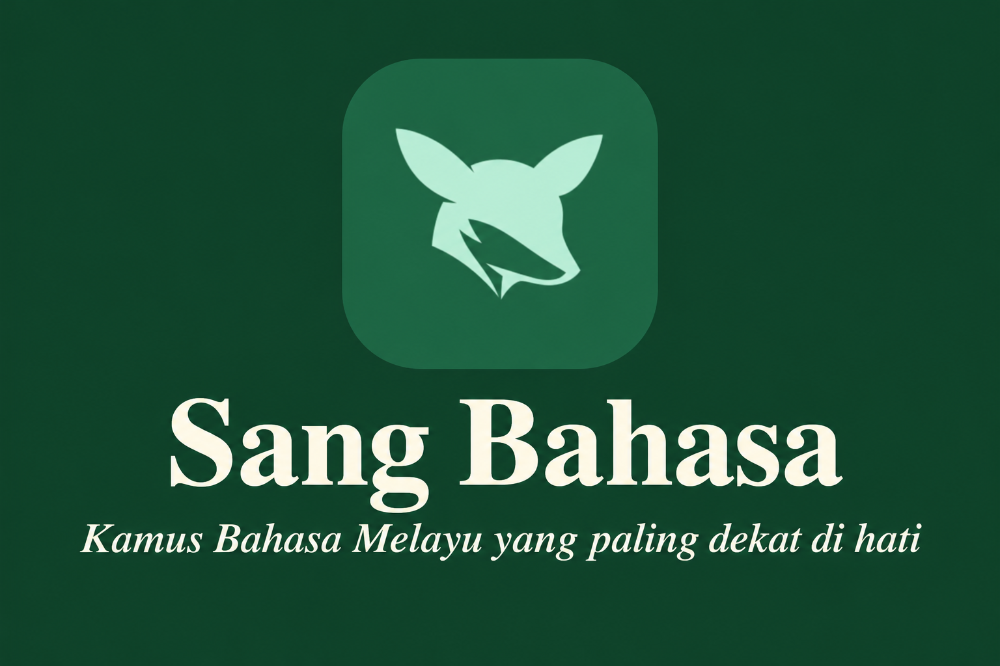

# Sang Bahasa

### Kamus Bahasa Melayu yang paling dekat di hati.

**[Kunjungi Laman Web](https://sang-bahasa.vercel.app)**

## Tentang Sang Bahasa

Sang Bahasa ialah kamus peribahasa dan bahasa klasik Melayu yang memfokuskan carian pantas, paparan yang kemas, dan kandungan sepenuhnya dalam Bahasa Melayu. Setiap entri bukan sekadar senarai maksud - ia datang dengan contoh ayat, kategori, entri berkaitan dan laluan bacaan yang membolehkan anda terus melompat dari satu peribahasa ke peribahasa yang lain.

## Ciri-ciri

### Laman Utama
- **Tren Dunia Hari Ini**: entri yang paling banyak dibuka hari ini
- **Yang Terbaharu**: entri terbaru yang ditambahkan!
- **Cuba Kad Misteri**: lompat ke entri rawak lengkap dengan confetti

### Kamus
- Tiga pintu masuk: **Semua**, **Peribahasa** dan **Bahasa Klasik**
- Peribahasa dipecahkan kepada pepatah, bidalan dan perumpamaan; Bahasa Klasik menandakan entri klasik dan istana
- Penapis kategori dan jenis terus pada setiap entri

### Halaman Entri
- Maksud, contoh ayat dan tarikh entri ditambah
- Untuk bahasa klasik: padanan Bahasa Standard dan ayat terjemahannya

## Hak Cipta & Kandungan

Semua kandungan dalam Sang Bahasa adalah hak milik pengendali tapak atau digunakan dengan izin. Sila rujuk halaman [Penafian](https://sang-bahasa.vercel.app/penafian) untuk butiran penuh mengenai ketepatan maklumat, had liabiliti dan penggunaan kandungan.

## Hala Tuju

- [ ] Mod gelap dan pilihan kebolehcapaian untuk pembacaan yang lebih selesa
- [ ] Sejarah carian dan entri yang dibuka baru-baru ini serta tren seronok anda
- [ ] Navigasi yang lebih cepat sepantas kilat

Dan banyak lagi melalui eksperimen, maklum balas dan detik "oh, patutlah!" yang kecil.

## 🎉 Sokong Sang Bahasa

Jika anda rasa Sang Bahasa berguna, boleh:
- ⭐ Beri bintang pada repositori
- 🍴 Fork untuk meneroka dan menambah baik
- 👀 Watch untuk melihat kemas kini
- 📢 Kongsikan dengan rakan yang selalu tertanya-tanya maksud sesuatu peribahasa
- ✍️ Hantar perkataan baharu atau laporan ralat melalui halaman Hubungi Kami

---

> **Dibina dengan 💚 untuk bahasa Melayu - Sang Bahasa ~ Bangga cipta Malaysia**
> 
> (dan terinspirasi semasa saya belajar bahasa Melayu)
